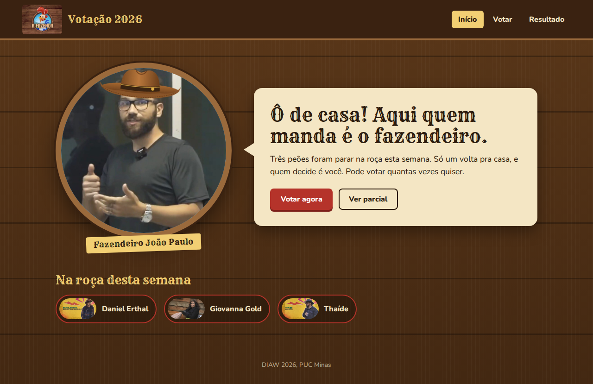
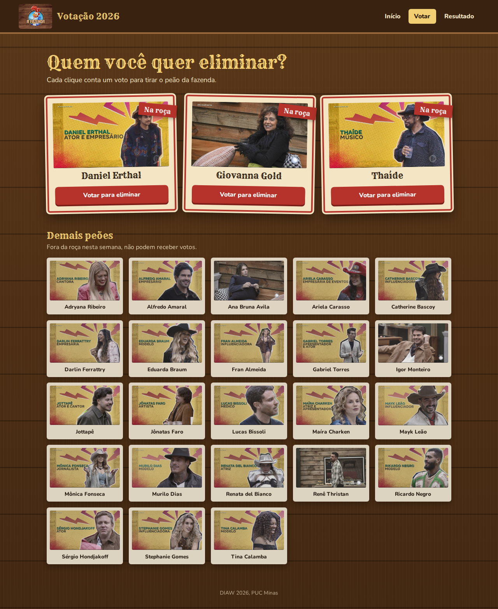
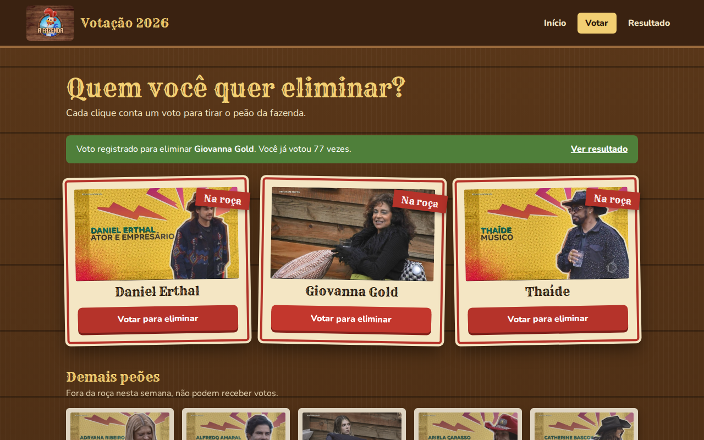
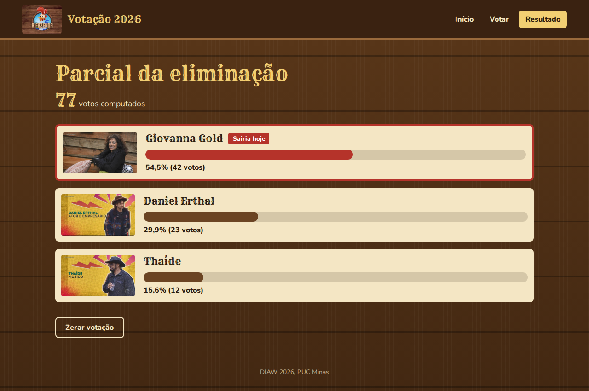
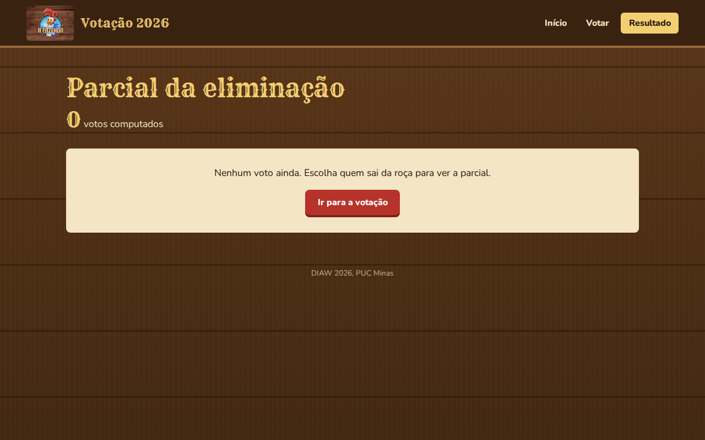

# 🐓 Projeto Votação A Fazenda 2026

Aplicação React + Vite para a votação de eliminação de **A Fazenda 2026**. O usuário vê quem está na roça, vota em quem deve deixar o programa e acompanha a parcial com o total de votos e o percentual de cada participante. Os votos ficam salvos no `localStorage` do navegador.

---

### Captura de Tela

- **Home**: Exibe o cabeçalho com a logo de A Fazenda e o menu (Início, Votar, Resultado). Logo abaixo aparece o fazendeiro (de chapéu, claro) com um balão de fala e os botões **Votar agora** e **Ver parcial**. No fim da página, uma faixa mostra os 3 participantes que estão na roça.
- **Votação**: Os 3 participantes da roça aparecem em destaque, em cartazes com borda vermelha e o selo **Na roça**, cada um com o botão **Votar para eliminar**. A cada voto, uma mensagem confirma em quem o usuário votou e quantas vezes já votou. Abaixo, a grade com os demais peões (fora da roça), sem botão de voto.
- **Resultado**: Mostra o total de votos computados e o placar dos 3 participantes da roça, ordenado do mais votado para o menos votado, com barra de progresso, percentual e quantidade de votos. O mais votado recebe o selo **Sairia hoje**. Quando não há votos, uma mensagem convida o usuário a votar. O botão **Zerar votação** reinicia a contagem.

|  |
|:----------------------------------------------------:|
|                        Home                          |

|  |
|:----------------------------------------------------:|
|                       Votação                        |

|  |
|:----------------------------------------------------:|
|                  Voto registrado                     |

|  |
|:----------------------------------------------------:|
|                      Resultado                       |

|  |
|:----------------------------------------------------:|
|                 Resultado sem votos                  |

---

## 📁 Estrutura do projeto

```
📁 VotacaoFazenda
│
├── 📁 public
│   ├── 🖼️ logo-fazenda.jpg
│   │   └── Logo de A Fazenda usada no cabeçalho
│   ├── 🤠 fazendeiro.jpg
│   │   └── Foto do fazendeiro exibida na Home
│   ├── 🔤 fonts
│   │   └── Fontes Rye e Nunito (funcionam sem internet)
│   └── 📁 participantes
│       └── Fotos dos 26 participantes (ex.: daniel-erthal.jpg, giovanna-gold.jpg, thaide.jpg)
│
├── 📁 src
│   │
│   ├── 📊 data
│   │   └── participantes.js
│   │       └── Lista de participantes (id, nome, foto, naRoca)
│   │
│   ├── ⚙️ services
│   │   └── votacaoService.js
│   │       └── Serviço responsável por listar participantes, registrar e contabilizar votos
│   │
│   ├── 🧩 components
│   │   ├── Header.jsx
│   │   │   └── Cabeçalho com logo e menu de navegação (NavLink)
│   │   └── ParticipanteCard.jsx
│   │       └── Card de um participante, com destaque para quem está na roça
│   │
│   ├── 📄 pages
│   │   ├── Home.jsx
│   │   │   └── Página inicial com o fazendeiro e quem está na roça
│   │   ├── Votacao.jsx
│   │   │   └── Página de votação para eliminar um participante da roça
│   │   └── Resultado.jsx
│   │       └── Página com a contabilização total e o placar da eliminação
│   │
│   ├── 🚀 App.jsx
│   │   └── Componente raiz com o BrowserRouter, o Header e as rotas
│   ├── 🎨 App.css
│   │   └── Estilização dos cards, grades, destaque da roça e placar
│   ├── 🎨 index.css
│   │   └── Estilos globais: fontes, cores, fundo de madeira, botões, cabeçalho e Home
│   └── main.jsx
│       └── Ponto de entrada da aplicação (renderiza o App)
│
├── 🌐 index.html
├── 📄 package.json
│   └── Dependências e scripts do npm
└── ⚡ vite.config.js
```

---

## 📦 Dependências

```bash
npm create vite@latest VotacaoFazenda -- --template react
cd VotacaoFazenda
npm install
npm install react-router-dom react-icons
npm run dev
```

- **react / react-dom**: biblioteca de componentes e renderização no navegador
- **vite**: servidor de desenvolvimento e build (`http://localhost:5173/`)
- **react-router-dom**: rotas da aplicação (`BrowserRouter`, `Routes`, `Route`, `Link`, `NavLink`)
- **react-icons**: ícones (opcional)

---

## ⚙️ `votacaoService.js`

Responsável por ler os participantes e registrar, guardar e contabilizar os votos no `localStorage` (chave `fazenda2026:votos`).

| Função | O que faz |
|---|---|
| `listarParticipantes()` | Retorna todos os participantes da temporada. |
| `listarNaRoca()` | Retorna apenas os participantes com `naRoca: true` (os únicos que podem receber votos). |
| `listarForaDaRoca()` | Retorna os participantes com `naRoca: false`. |
| `obterVotos()` | Lê os votos salvos no `localStorage` e devolve um objeto no formato `{ [id]: quantidade }`. Se não houver nada salvo, devolve `{}`. |
| `registrarVoto(id)` | Soma 1 voto para o participante informado, salva no `localStorage` e devolve o objeto de votos atualizado. Lança erro se o participante não estiver na roça. |
| `calcularTotalVotos(votos)` | Soma todos os votos do objeto recebido. |
| `calcularResultado(votos)` | Devolve a lista dos participantes da roça com os campos extras `votos` e `percentual`, ordenada do mais votado para o menos votado. |
| `zerarVotos()` | Remove todos os votos do `localStorage`. |

---

## 🧭 Rotas (`App.jsx`)

| Rota | Componente | Descrição |
|---|---|---|
| `/` | `Home` | Página inicial com o fazendeiro, o balão de boas-vindas e quem está na roça. |
| `/votacao` | `Votacao` | Lista os 3 participantes da roça em destaque com o botão **Votar para eliminar** e, abaixo, os demais peões. Exibe uma mensagem a cada voto registrado. |
| `/resultado` | `Resultado` | Mostra o total de votos e o placar ordenado com barra, percentual e quantidade de votos. Permite zerar a votação. |

---

## 🧩 `ParticipanteCard` (componente)

Recebe por **props** o objeto `participante` e, opcionalmente, a função `onVotar`. Exibe a foto e o nome. Quando `participante.naRoca` é `true`, aplica a classe `card-roca` e mostra o selo **Na roça**. O botão **Votar para eliminar** só aparece quando `onVotar` é passado, e ao ser clicado chama `onVotar(participante)`. É o mesmo componente usado tanto para os participantes da roça quanto para os demais peões.

---

## 📊 `participantes.js` (dados)

Array exportado por padrão com um objeto por participante:

```js
{ id: 6, nome: 'Daniel Erthal', foto: '/participantes/daniel-erthal.jpg', naRoca: true }
```

O caminho da foto começa com `/` porque os arquivos da pasta `public` são servidos na raiz da aplicação pelo Vite.

---

## 🔗 Documentação e links úteis

- [React: documentação oficial](https://react.dev/learn)
- [Vite: guia](https://vite.dev/guide/)
- [React Router: documentação](https://reactrouter.com/home)
- [MDN: localStorage](https://developer.mozilla.org/pt-BR/docs/Web/API/Window/localStorage)

---

## 📄 Licença

Este projeto está licenciado sob a licença MIT — veja o arquivo [LICENSE](LICENSE) para mais detalhes.
